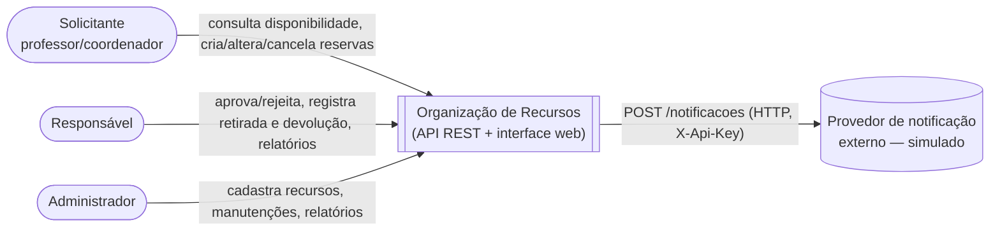
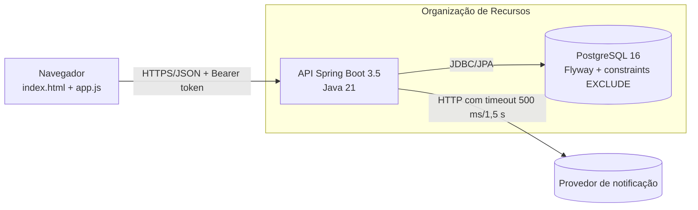
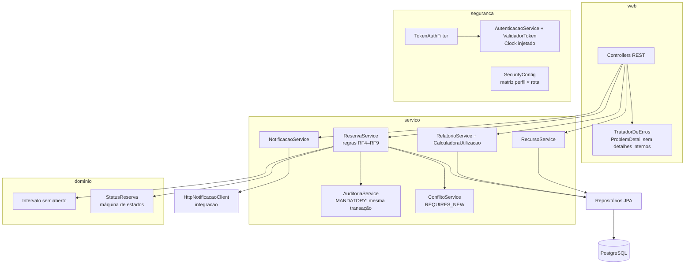
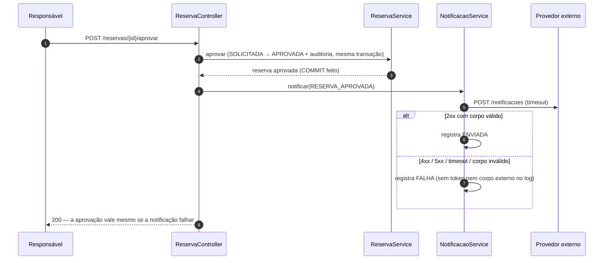

# Arquitetura — Organização de Recursos

Documento de arquitetura com diagramas no estilo **C4** (Mermaid, renderizados pelo próprio GitHub),
sequências críticas e o ciclo **ATAM** (utility tree, cenários, riscos e trade-offs).
Decisões registradas em [`docs/adr/`](adr/).

## 1. Direcionadores de negócio
1. **Nenhum conflito de horário**: sala, material ou professor nunca podem ter duas reservas ativas que se sobreponham.
2. **Controle de recursos restritos**: laboratórios e auditório só valem depois de aprovados por um Responsável.
3. **Rastreabilidade**: toda mudança de estado tem autor, instante e motivo (auditoria).
4. **Gestão**: relatório de utilização e de carga horária para a coordenação.

## 2. Diagrama de contexto (C4 nível 1)


## 3. Diagrama de contêineres (C4 nível 2)


## 4. Diagrama de componentes (C4 nível 3) — API


## 5. Sequências críticas

### 5.1 Criação de reserva com proteção contra dupla reserva (RF5/RF6)
```mermaid
sequenceDiagram
    autonumber
    participant S as Solicitante
    participant C as ReservaController
    participant R as ReservaService
    participant DB as PostgreSQL
    S->>C: POST /reservas (token)
    C->>R: criar(usuário, recurso, professor, intervalo)
    R->>DB: há manutenção sobreposta?
    R->>DB: há reserva ativa sobreposta (recurso / professor)?
    alt camada 1 detecta conflito
        R->>DB: registra conflito evitado (transação própria)
        R-->>C: 409 CONFLITO_HORARIO
    else livre
        R->>DB: BEGIN; INSERT reserva; INSERT auditoria; COMMIT
        alt duas requisições simultâneas passaram juntas pela camada 1
            DB-->>R: 23P01 exclusion_violation (constraint EXCLUDE)
            R-->>C: 409 CONFLITO_HORARIO
        else deadlock entre as checagens (DEF-002)
            DB-->>R: 40P01 deadlock_detected
            R->>DB: repete a operação (até 3x) → 201 ou 409
        end
        R-->>C: 201 (APROVADA ou SOLICITADA se recurso restrito)
    end
```

### 5.2 Aprovação de recurso restrito com notificação externa (RF7/RF11)


## 6. ATAM — ciclo 01

### 6.1 Utility tree (Importância, Dificuldade em A/M/B)
| Atributo (ISO/IEC 25010) | Refinamento | Cenário folha | (I, D) |
|---|---|---|---|
| Adequação funcional | Integridade da agenda | CEN-01: 20 pedidos simultâneos, mesmo recurso e horário → 1 aceito | (A, A) |
| Adequação funcional | Regras de estado | CEN-02: recurso restrito só é usado após aprovação | (A, B) |
| Segurança | Autorização | CEN-03: Solicitante tenta alterar reserva de outro pelo id → 403 | (A, B) |
| Segurança | Confidencialidade de erros | CEN-04: erro de validação/servidor não expõe stack trace nem SQL | (A, B) |
| Eficiência de performance | Tempo de resposta | CEN-05: 50 usuários simultâneos → p95 ≤ 300 ms, erro real < 1% | (A, M) |
| Confiabilidade | Tolerância a falhas | CEN-06: provedor de notificação fora do ar não impede a aprovação | (M, B) |
| Manutenibilidade | Testabilidade | CEN-07: regra de tempo testável sem `Thread.sleep` (Clock injetado) | (M, B) |

### 6.2 Cenários prioritários em seis partes
| Parte | CEN-01 (dupla reserva) | CEN-05 (carga) | CEN-06 (notificação) |
|---|---|---|---|
| Fonte | 20 Solicitantes | 50 usuários | Provedor externo |
| Estímulo | `POST /reservas` ao mesmo tempo, mesmo recurso/horário | login + consulta + reserva disputada por 60 s | responde 500 ou demora 2 s |
| Ambiente | operação normal, pico | aplicação + PostgreSQL no runner do CI | operação normal |
| Artefato | `ReservaService` + tabela `reserva` | API completa | `HttpNotificacaoClient` |
| Resposta | 1 aceita (201), demais 409, nunca 500 | atende sem 5xx | aprovação confirmada; notificação `FALHA` registrada |
| Medida | contagem no **banco** = 1 em 5 repetições | p95 ≤ 300 ms; erro real < 1% (409 não é erro) | 100% das aprovações concluídas; timeout ≤ 1,5 s |

### 6.3 Abordagens e táticas encontradas no código (evidência)
| Cenário | Tática | Evidência |
|---|---|---|
| CEN-01 | Restrição no banco (constraint `EXCLUDE USING gist`) + verificação na aplicação + repetição de vítima de deadlock | `V1__schema.sql` (constraints `reserva_sem_sobreposicao_*`), `ReservaService.comProtecaoDeConcorrencia` |
| CEN-03 | Autorização por rota + verificação de posse no serviço | `SecurityConfig`, `ReservaService.exigirPosseSeSolicitante/transitar` |
| CEN-04 | Tratamento centralizado de erros com mensagem neutra | `TratadorDeErros`, `server.error.include-stacktrace=never` |
| CEN-06 | Timeout + tradução de erros + degradação graciosa | `HttpNotificacaoClient`, `NotificacaoService` |
| CEN-07 | Injeção de dependência do relógio | `RelogioConfig`, `ValidadorToken(Clock)` |

### 6.4 Descobertas
- **Ponto de sensibilidade:** tamanho do pool de conexões (Hikari) × tempo de resposta no pico de reservas — cada criação abre transação curta; com pool pequeno, as requisições enfileiram.
- **Ponto de trade-off:** validade da sessão (`app.sessao.validade`, 8 h). Longa = menos logins (desempenho, usabilidade); curta = menor janela de uso de token vazado (segurança). Mitigação: logout revoga o token no banco.
- **Ponto de trade-off:** estados que ocupam a agenda incluem `SOLICITADA`. Bloquear o horário enquanto aguarda aprovação evita conflito na aprovação (integridade), mas pode segurar um horário que será rejeitado (disponibilidade).
- **Risco (tratado):** concorrência entre as duas constraints de exclusão gerava deadlock → 500 (DEF-002). Tratado com repetição; risco residual: latência extra sob disputa intensa.
- **Risco (aceito):** sem fila/retry para notificação com falha — mensagens com `FALHA` não são reenviadas automaticamente.
- **Não-risco:** cálculo do relatório em memória é adequado **desde que** o volume por período fique na casa de milhares de reservas (premissa registrada).
- **Tema de risco:** dependência de garantias do banco (PostgreSQL) para a regra mais crítica; trocar de banco exigiria reimplementar a proteção (ver ADR-002).

### 6.5 Divergências entre documentação e código
Nenhuma divergência aberta. A regra "alterar reserva de recurso restrito já aprovada" foi decidida como **não permitida** (exige nova solicitação) e está coberta por teste (`ReservaApiIT.reservaRestritaJaAprovadaNaoPodeSerAlterada`).
